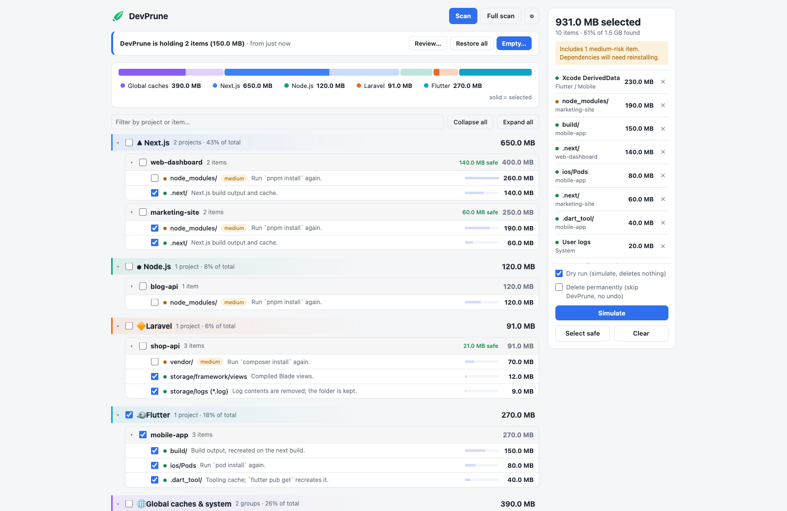

<h1> DevPrune</h1>

A local dashboard that finds and removes the caches and build artifacts developers accumulate:
`node_modules`, `.next`, `vendor`, Flutter `build/`, Xcode DerivedData, the pnpm store, Gradle caches and more.

Run one command, your browser opens, and you see every project grouped by framework with sizes and checkboxes.

> **Warning: cleaning removes files.** By default DevPrune moves items into its own holding area (not the macOS
> Trash), where you can restore them until you empty it; disk space is only freed when it is emptied. Items that are
> cleaned by a tool command (`pnpm store prune`, `brew cleanup`, ...) and the macOS Trash itself are deleted for real,
> and you can tick **Delete permanently** to skip the holding area. Use **Simulate** first, and read the risk label
> and note next to each item. This is alpha software. Use it at your own risk.

<picture>
  <source media="(prefers-color-scheme: dark)" srcset="https://raw.githubusercontent.com/dhikicheeks/devprune/main/docs/screenshot-dark.png">
  
</picture>

## Features

- Groups results by framework, then project, then item, with sizes, a stacked bar of where the space went, a filter
  box, and a "safe to delete" amount per project.
- Built-in rules for **Laravel**, **Flutter**, **Next.js** and **Node.js**, plus global caches
  (pnpm, npm, Yarn, Composer, Dart pub, Xcode, CocoaPods, Gradle, Homebrew, ...).
- Uses the official cleanup command where one exists (`pnpm store prune`, `npm cache clean`, `composer clear-cache`,
  `dart pub cache clean`, `brew cleanup`, ...).
- Risk labels: **safe** (recreated automatically), **medium** (needs a command like `npm install`), **careful**.
- Cancelable scan. Results are cached, so the next start is instant. A quick scan reuses the sizes of slow folders;
  a full scan measures everything again.
- Pick items, review them in a side panel (with a warning if any are medium or careful risk), then confirm.
- Live progress while cleaning: per-item status, a stop button, and a summary of what was cleaned, what failed and why.
  Reloading the page reconnects to a running scan or cleaning. Simulate mode changes nothing.
- Safe to interrupt: pressing Ctrl+C while a cleanup runs asks first (press it twice to stop after the current item);
  closing the terminal or `kill` stops after the current item. Moved items are journaled, so nothing is left half-done.
- Undo: cleaned folders are moved aside, not deleted. A bar at the top shows what DevPrune is holding, with
  **Review**, **Restore all** and **Empty**; restoring over something that was created again asks first.
- Choose your own terminal command name from the dashboard.
- No dependencies. Python standard library only.

## Install

Requires macOS and Python 3.9 or newer. Not on PyPI yet.

The easiest way is [pipx](https://pipx.pypa.io/), which installs command-line tools in their own environment:

```sh
pipx install git+https://github.com/dhikicheeks/devprune.git
```

To update later, run the same command with `--force`.

Or install from source:

```sh
git clone https://github.com/dhikicheeks/devprune.git
cd devprune
python3 -m pip install -e .
```

## Use

```sh
devprune        # or the short alias: dp
```

Options: `--port 8765`, `--no-browser`, `--version`.

**Custom command name:** open the "Terminal command" card in the dashboard, type a name (for example `bersih`) and
click *Create command*. This writes a small launcher script to `~/.local/bin`; make sure that folder is on your `PATH`.
The app only ever replaces or removes launchers it created itself, and refuses names of existing commands.

By default it scans these folders in your home directory if they exist: `Projects`, `Developer`, `Code`, `Sites`,
`www`, `htdocs`, `Documents`, `Desktop`, `Herd`, `Valet`.

## Configuration (optional)

`~/.config/devprune/config.json`:

```json
{
  "roots": ["~/work"],
  "exclude": ["~/work/keep-this-project"],
  "project_rules": [
    {
      "framework": "Rust",
      "detect": {"files_all": ["Cargo.toml"]},
      "targets": [{"path": "target", "label": "target/", "risk": "safe", "note": "Run `cargo build` again."}]
    }
  ]
}
```

Excluded folders are never scanned or deleted. Rules from this file cannot run commands.
See [CONTRIBUTING.md](https://github.com/dhikicheeks/devprune/blob/main/CONTRIBUTING.md) for the rule format.

## Safety

- Only paths inside your home folder can be deleted. The home folder itself, `~/.ssh`, `~/.gnupg`, `~/.aws`,
  `~/.kube`, `Library/Keychains`, `Library/Mail`, `Library/Messages` and `Library/Application Support` are refused.
- Symlinks are never followed for deletion.
- Only items from the latest scan (or a validated cache) can be deleted, and only with rules from the built-in data.
- The server listens on `127.0.0.1` only and requires a per-session token. It also checks the `Host` and `Origin`
  headers and sets a strict Content-Security-Policy.
- Gradle caches are not removed while a Gradle daemon is running.

Found a safety problem? See [SECURITY.md](https://github.com/dhikicheeks/devprune/blob/main/SECURITY.md).

## Limitations

- macOS only for now.
- Only folders inside your home directory are supported (not external volumes such as `/Volumes/...`).
- Tested in Chrome. The web UI has no automated tests yet.
- Sizes are measured with `du`, so a full scan of a large pnpm store can take 15 to 30 seconds.

## Development

```sh
python3 -m venv .venv
.venv/bin/pip install -e . pytest ruff
.venv/bin/pytest
.venv/bin/ruff check .
```

## License

[MIT](LICENSE)
